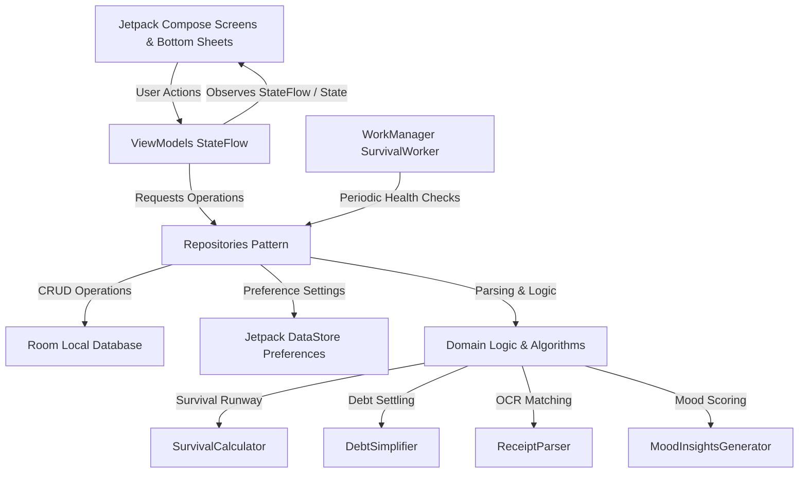

# Student Expense Tracker (ExTrack) - Detailed Technical & Feature Guide 📱💰

An exhaustive architectural and feature specification guide for **ExTrack**, an offline-first Android financial operating system built specifically for college students and young adults using **Jetpack Compose**, **Kotlin Coroutines**, **Room Database**, **Dagger Hilt**, and **Google ML Kit**.

---

## 📑 Table of Contents
1. [Application Overview](#-application-overview)
2. [Architectural Blueprint](#-architectural-blueprint)
3. [Deep-Dive Feature Breakdown](#-deep-dive-feature-breakdown)
   - [1. Dashboard & "Days Left" Survival Meter](#1-dashboard--days-left-survival-meter)
   - [2. Dynamic Monthly Budget System](#2-dynamic-monthly-budget-system)
   - [3. Transaction Management & Swipe Gestures](#3-transaction-management--swipe-gestures)
   - [4. AI-Powered Receipt Scanner (OCR)](#4-ai-powered-receipt-scanner-ocr)
   - [5. Mood-Based Spending Insights](#5-mood-based-spending-insights)
   - [6. Group Bill Splitting & Debt Simplification](#6-group-bill-splitting--debt-simplification)
   - [7. Financial Reports & Analytics](#7-financial-reports--analytics)
   - [8. Obsidian Dark Mode & Fintech Design System](#8-obsidian-dark-mode--fintech-design-system)
   - [9. Background Automation & WorkManager](#9-background-automation--workmanager)
4. [Algorithms & Business Logic Explained](#-algorithms--business-logic-explained)
   - [Survival Runway Calculation](#survival-runway-calculation)
   - [Minimum Cash Flow Debt Simplifier](#minimum-cash-flow-debt-simplifier)
   - [Receipt Regex Heuristic Parser](#receipt-regex-heuristic-parser)
5. [Database Schema & DataStore Preferences](#-database-schema--datastore-preferences)
6. [Complete Codebase File Directory](#-complete-codebase-file-directory)
7. [Testing & Build Artifacts](#-testing--build-artifacts)

---

## 🌟 Application Overview

### The Problem
College students frequently face unpredictable monthly expenses: irregular pocket money, part-time job payouts, textbooks, rent/hostel dues, and group canteen outings. Traditional finance apps are bloated with investments, loans, and credit cards, yet fail to answer the student's most vital daily question:  
> *"Will my money survive until allowance day, and how much can I safely spend today?"*

### The Solution: ExTrack
ExTrack re-engineers personal finance around the student lifecycle:
- **Survival Runway**: Continuously tells students how many days of runway they have left based on real spending velocity.
- **Dynamic Budgeting**: Automatically aligns the monthly budget with actual incoming funds.
- **Smart Bill Splitting**: Solves messy group splits without awkward math by minimizing physical payments.
- **Receipt OCR**: Extracts transaction details instantly from camera snapshots.
- **Mindful Spending**: Tracks the emotional context (Happy, Stressed, Bored) behind every rupee spent.
- **100% Privacy & Offline-First**: Stored locally on the user's device with zero mandatory cloud accounts.

---

## 🏗 Architectural Blueprint

ExTrack follows official Android **Clean Architecture** with **MVVM (Model-View-ViewModel)** and **Unidirectional Data Flow (UDF)**.



### Core Architecture Layers:
1. **Presentation Layer (`ui/`)**:
   - Declarative UI rendered with **Jetpack Compose** and **Material 3**.
   - Stateless composables consuming reactive `StateFlow` from ViewModels.
   - Fluid micro-interactions: swipe gestures, nested bottom sheets (`ModalBottomSheet`), and animated progress bars.
2. **Domain Layer (`domain/`)**:
   - Pure Kotlin business logic and algorithms decoupled from Android SDK classes for high unit-test coverage.
3. **Data Layer (`data/`)**:
   - **Room Database (`data/local/`)**: SQLite abstraction storing transactions, group splits, and member ledgers.
   - **Preferences (`data/preferences/`)**: Jetpack DataStore storing typed primitives for dark mode, user identity, budget settings, and notification configurations.
   - **Repositories (`data/repository/`)**: Single source of truth abstracting data sources for ViewModels.
4. **Dependency Injection (`di/`)**:
   - Fully automated dependency injection using **Dagger Hilt** (`@HiltViewModel`, `@Inject`, `@Singleton`).

---

## 🚀 Deep-Dive Feature Breakdown

### 1. Dashboard & "Days Left" Survival Meter
- **Core Component**: [`SurvivalMeterCard`](file:///c:/Users/revan/AndroidStudioProjects/ex_track/app/src/main/java/com/example/studentexpensetracker/ui/home/HomeScreen.kt)
- **Logic Provider**: [`SurvivalCalculator.kt`](file:///c:/Users/revan/AndroidStudioProjects/ex_track/app/src/main/java/com/example/studentexpensetracker/domain/SurvivalCalculator.kt)
- **How it Works**:
  1. Computes your **daily spending velocity** over a selectable 7-day or 14-day trailing analysis window.
  2. Divides the current balance by the average daily spend to compute **Runway Days Left**.
  3. Projects days remaining until your configured **Allowance Day** (e.g. Day 1 of next month).
  4. Computes **Safe Daily Limit**: $\frac{\text{Current Balance}}{\text{Days Until Allowance}}$.
  5. Computes **Today's Remaining Allowance**: $\text{Safe Daily Limit} - \text{Expenses Spent Today}$.
  6. Visual Status Indicators:
     - 🟢 **Safe**: Runway exceeds days until next allowance.
     - 🟠 **Tight**: Runway is within 3 days of allowance day.
     - 🔴 **Danger**: Funds will expire before the next allowance or balance is exhausted.

---

### 2. Dynamic Monthly Budget System
- **Core Component**: [`BudgetProgressCard`](file:///c:/Users/revan/AndroidStudioProjects/ex_track/app/src/main/java/com/example/studentexpensetracker/ui/home/HomeScreen.kt)
- **State Coordinator**: [`HomeViewModel.kt`](file:///c:/Users/revan/AndroidStudioProjects/ex_track/app/src/main/java/com/example/studentexpensetracker/ui/home/HomeViewModel.kt) & [`UserPreferencesRepository.kt`](file:///c:/Users/revan/AndroidStudioProjects/ex_track/app/src/main/java/com/example/studentexpensetracker/data/preferences/UserPreferencesRepository.kt)
- **How it Works**:
  - **Automatic Income Syncing**: When a user records income (e.g., ₹10,000 job + ₹1,000 allowance = ₹11,000.00), the app automatically establishes ₹11,000.00 as the baseline monthly budget.
  - **Dynamic Remaining Calculation**: If ₹40.00 is spent, the card displays:  
    `₹40.00 / ₹11,000.00` and `₹10,960.00 left` (0% spent), staying in synchronization with Total Balance.
  - **Click-to-Edit Custom Budget**: Tapping the card opens a modern `ModalBottomSheet` where students can:
    - Set an explicit custom spending limit (e.g., ₹8,000).
    - Quick-tap *"Match Monthly Income"* to re-sync.
    - Tap *"Reset"* to return to automatic mode.
  - **Settings Integration**: Configurable anytime via `Settings -> Preferences -> Monthly Budget`.

---

### 3. Transaction Management & Swipe Gestures
- **Core Screens**: [`TransactionsScreen.kt`](file:///c:/Users/revan/AndroidStudioProjects/ex_track/app/src/main/java/com/example/studentexpensetracker/ui/transactions/TransactionsScreen.kt), [`AddTransactionScreen.kt`](file:///c:/Users/revan/AndroidStudioProjects/ex_track/app/src/main/java/com/example/studentexpensetracker/ui/transactions/AddTransactionScreen.kt), [`EditTransactionScreen.kt`](file:///c:/Users/revan/AndroidStudioProjects/ex_track/app/src/main/java/com/example/studentexpensetracker/ui/transactions/EditTransactionScreen.kt)
- **Gesture Helper**: [`SwipeableItemWithActions.kt`](file:///c:/Users/revan/AndroidStudioProjects/ex_track/app/src/main/java/com/example/studentexpensetracker/ui/components/SwipeableItemWithActions.kt)
- **Visual Categorization**: [`CategoryUiHelper.kt`](file:///c:/Users/revan/AndroidStudioProjects/ex_track/app/src/main/java/com/example/studentexpensetracker/ui/components/CategoryUiHelper.kt)
- **Key Capabilities**:
  - **Interactive Swipe**: Swiping any transaction item reveals dual actions:
    - ✏️ **Edit (Blue)**: Swiping right or tapping Edit navigates to the pre-filled `EditTransactionScreen`.
    - 🗑️ **Delete (Red)**: Swiping left triggers a bottom-sheet confirmation dialog.
    - Prevents accidental overscroll off-screen using drag clamps (`-160.dp` to `0.dp`).
  - **Category Auto-Tagging**: Keywords in transaction titles or notes automatically assign contextual icons and luminous colors (e.g., *Uber/Bus* → Bus icon + Sky Blue; *Books/Xerox* → Book icon + Purple; *Food/Canteen* → Restaurant icon + Orange).
  - **Filtering & Search**: Real-time substring search, category chip filters, and type filtering (All, Expense, Income).

---

### 4. AI-Powered Receipt Scanner (OCR)
- **Core Screen**: [`ReceiptScannerScreen.kt`](file:///c:/Users/revan/AndroidStudioProjects/ex_track/app/src/main/java/com/example/studentexpensetracker/ui/scanner/ReceiptScannerScreen.kt)
- **ML Logic**: [`ReceiptParser.kt`](file:///c:/Users/revan/AndroidStudioProjects/ex_track/app/src/main/java/com/example/studentexpensetracker/domain/scanner/ReceiptParser.kt)
- **Image Pipeline**: [`ReceiptStorageManager.kt`](file:///c:/Users/revan/AndroidStudioProjects/ex_track/app/src/main/java/com/example/studentexpensetracker/domain/scanner/ReceiptStorageManager.kt)
- **How it Works**:
  1. The student selects an image from gallery or captures a physical receipt using the camera FAB.
  2. Google **ML Kit Text Recognition** processes the receipt offline.
  3. [`ReceiptParser`](file:///c:/Users/revan/AndroidStudioProjects/ex_track/app/src/main/java/com/example/studentexpensetracker/domain/scanner/ReceiptParser.kt) evaluates text lines with regex heuristics:
     - Extracts the **Total Amount** by scanning keywords like `TOTAL`, `GRAND TOTAL`, `AMOUNT DUE`, `NET PAYABLE`, `₹`, or `INR`.
     - Detects the **Merchant Name** from prominent header blocks.
     - Parses the **Date** across international and Indian formats (`DD/MM/YYYY`, `MM/DD/YYYY`, `DD-MMM-YYYY`).
     - Infers the **Category** based on product keywords (e.g., "coffee", "latte" → Food & Dining).
  4. Compressed images are persisted in app internal storage (`/receipts/`) and linked to Room transactions with a receipt badge.

---

### 5. Mood-Based Spending Insights
- **Core Engine**: [`MoodInsightsGenerator.kt`](file:///c:/Users/revan/AndroidStudioProjects/ex_track/app/src/main/java/com/example/studentexpensetracker/ui/reports/mood/MoodInsightsGenerator.kt)
- **UI Card**: [`WeeklyMoodSummaryCard`](file:///c:/Users/revan/AndroidStudioProjects/ex_track/app/src/main/java/com/example/studentexpensetracker/ui/home/HomeScreen.kt)
- **How it Works**:
  - Every transaction can optionally record emotional state:
    - 😃 **Happy / Celebratory**
    - 😰 **Stressed / Anxious**
    - 🥱 **Bored / Impulsive**
    - 😔 **Sad / Comfort Spending**
    - 😐 **Neutral / Essential**
  - The engine analyzes weekly spending patterns:
    - Identifies your **Dominant Mood** and percentage of mindful vs impulsive expenses.
    - Generates proactive coaching alerts (e.g. *"45% of your expenses occurred during stress—consider a 24-hour pause before shopping when stressed."*).

---

### 6. Group Bill Splitting & Debt Simplification
- **Screens**: [`SplitScreen.kt`](file:///c:/Users/revan/AndroidStudioProjects/ex_track/app/src/main/java/com/example/studentexpensetracker/ui/split/SplitScreen.kt), [`GroupDetailScreen.kt`](file:///c:/Users/revan/AndroidStudioProjects/ex_track/app/src/main/java/com/example/studentexpensetracker/ui/split/GroupDetailScreen.kt)
- **Algorithm**: [`DebtSimplifier.kt`](file:///c:/Users/revan/AndroidStudioProjects/ex_track/app/src/main/java/com/example/studentexpensetracker/domain/split/DebtSimplifier.kt)
- **Calculator**: [`SplitCalculator.kt`](file:///c:/Users/revan/AndroidStudioProjects/ex_track/app/src/main/java/com/example/studentexpensetracker/domain/split/SplitCalculator.kt)
- **Key Capabilities**:
  - Create groups (e.g., "Apartment 302", "Manali Trip", "Project Group").
  - Add members and log multi-payer shared expenses.
  - Supports both **Equal Splitting** and **Custom Unequal Shares**.
  - **Smart Debt Simplification**: Computes net balances per member and matches maximal debtors with maximal creditors, reducing complex web of debts down to minimum required cash transfers.

---

### 7. Financial Reports & Analytics
- **Core Screen**: [`ReportsScreen.kt`](file:///c:/Users/revan/AndroidStudioProjects/ex_track/app/src/main/java/com/example/studentexpensetracker/ui/reports/ReportsScreen.kt)
- **ViewModel**: [`ReportsViewModel.kt`](file:///c:/Users/revan/AndroidStudioProjects/ex_track/app/src/main/java/com/example/studentexpensetracker/ui/reports/ReportsViewModel.kt)
- **Features**:
  - Dynamic Bar & Donut chart breakdowns of monthly spending.
  - Visual category breakdown tiles with category badges and percentages.
  - Mood distribution analysis with visual health ratings.

---

### 8. Obsidian Dark Mode & Fintech Design System
- **Palette Tokens**: [`Color.kt`](file:///c:/Users/revan/AndroidStudioProjects/ex_track/app/src/main/java/com/example/studentexpensetracker/ui/theme/Color.kt)
- **Theme Definition**: [`Theme.kt`](file:///c:/Users/revan/AndroidStudioProjects/ex_track/app/src/main/java/com/example/studentexpensetracker/ui/theme/Theme.kt)
- **Design Tokens**:
  - **Background**: Deep Obsidian Midnight (`#0B0F19`).
  - **Surface Elevation**: `#141C30` with subtle border stroke (`#26334D` at 35% alpha).
  - **Primary Accent**: Luminous Indigo 400 (`#818CF8`).
  - **Secondary Accent**: Sky 400 (`#38BDF8`).
  - **Semantic Greens & Reds**: Luminous Emerald 400 (`#34D399`) and Rose 400 (`#F87171`) for maximum contrast against dark backgrounds.
  - **Grouped Settings Cards**: Settings rows are enclosed in rounded surface cards ([`SettingsCard`](file:///c:/Users/revan/AndroidStudioProjects/ex_track/app/src/main/java/com/example/studentexpensetracker/ui/settings/SettingsScreen.kt)) with distinct vibrant icon badge containers and inset dividers.

---

### 9. Background Automation & WorkManager
- **Worker**: [`SurvivalWorker.kt`](file:///c:/Users/revan/AndroidStudioProjects/ex_track/app/src/main/java/com/example/studentexpensetracker/worker/SurvivalWorker.kt)
- **How it Works**:
  - Enqueues a periodic 24-hour background job via `WorkManager`.
  - Runs calculations on recent expenses and remaining days.
  - Automatically posts notification warnings to students when:
    - Their remaining daily budget has been exceeded.
    - Their survival runway drops into `TIGHT` or `DANGER` territory.

---

## 🧮 Algorithms & Business Logic Explained

### Survival Runway Calculation
Located in [`SurvivalCalculator.kt`](file:///c:/Users/revan/AndroidStudioProjects/ex_track/app/src/main/java/com/example/studentexpensetracker/domain/SurvivalCalculator.kt):

$$\text{Daily Burn Rate} = \frac{\sum \text{Expenses in Window}}{\text{Days in Window (e.g., 14)}}$$

$$\text{Runway (Days Left)} = \begin{cases} 
0 & \text{if Balance} \le 0 \\
\infty\ (99+) & \text{if Daily Burn Rate} = 0 \\
\left\lfloor\frac{\text{Balance}}{\text{Daily Burn Rate}}\right\rfloor & \text{otherwise}
\end{cases}$$

$$\text{Safe Daily Limit} = \frac{\text{Current Balance}}{\max(1, \text{Days Until Allowance})}$$

---

### Minimum Cash Flow Debt Simplifier
Located in [`DebtSimplifier.kt`](file:///c:/Users/revan/AndroidStudioProjects/ex_track/app/src/main/java/com/example/studentexpensetracker/domain/split/DebtSimplifier.kt):

1. **Calculate Net Amount for each member**:
   $$\text{Net}[i] = \text{Total Paid by } i - \text{Total Share of } i$$
2. **Partition Members**:
   - $\text{Creditors}: \{i \mid \text{Net}[i] > 0\}$
   - $\text{Debtors}: \{j \mid \text{Net}[j] < 0\}$
3. **Greedy Settlement Loop**:
   - Pick the maximum debtor $D$ and maximum creditor $C$.
   - Settle $\min(|\text{Net}[D]|, \text{Net}[C])$.
   - Update balances and repeat until all balances are zero ($\sum \text{Net} = 0$).
   - Reduces $O(N^2)$ potential payments down to at most $N-1$ clean transactions.

---

### Receipt Regex Heuristic Parser
Located in [`ReceiptParser.kt`](file:///c:/Users/revan/AndroidStudioProjects/ex_track/app/src/main/java/com/example/studentexpensetracker/domain/scanner/ReceiptParser.kt):

- **Amount Detection**:
  ```regex
  (?:total|amount|due|payable|grand\s*total)[\s:=]*[₹$]?\s*([0-9]+[.,][0-9]{2})
  ```
- Scans candidate floating point numbers from the bottom up, prioritizing lines containing monetary totals.
- Filters out non-monetary integers such as phone numbers, dates, and order numbers.

---

## 💾 Database Schema & DataStore Preferences

### 1. Room Database (`AppDatabase.kt` - Version 3)

#### Table: `transactions`
| Column Name | Type | Description |
|---|---|---|
| `id` | INTEGER (PK, AutoGenerate) | Unique transaction ID |
| `amount` | REAL | Transaction value in INR (₹) |
| `type` | TEXT | `EXPENSE` or `INCOME` |
| `dateTime` | INTEGER | Timestamp in milliseconds |
| `note` | TEXT (Nullable) | Note formatted as `Category: Description` |
| `receiptImagePath` | TEXT (Nullable) | Local file path to scanned receipt image |
| `mood` | TEXT (Nullable) | Emotional tag (`Happy`, `Stressed`, etc.) |

#### Table: `split_groups`
| Column Name | Type | Description |
|---|---|---|
| `id` | INTEGER (PK, AutoGenerate) | Group identifier |
| `name` | TEXT | Group name |
| `createdAt` | INTEGER | Creation timestamp |

#### Table: `group_members`
| Column Name | Type | Description |
|---|---|---|
| `id` | INTEGER (PK, AutoGenerate) | Member identifier |
| `groupId` | INTEGER (FK) | Reference to `split_groups.id` |
| `name` | TEXT | Member display name |

#### Table: `group_expenses`
| Column Name | Type | Description |
|---|---|---|
| `id` | INTEGER (PK, AutoGenerate) | Shared expense record ID |
| `groupId` | INTEGER (FK) | Reference to `split_groups.id` |
| `payerMemberId` | INTEGER (FK) | ID of member who paid |
| `description` | TEXT | Description of expense |
| `amount` | REAL | Total amount paid |
| `dateTime` | INTEGER | Timestamp |

#### Table: `expense_splits`
| Column Name | Type | Description |
|---|---|---|
| `id` | INTEGER (PK, AutoGenerate) | Split row ID |
| `expenseId` | INTEGER (FK) | Reference to `group_expenses.id` |
| `memberId` | INTEGER (FK) | Member who owes this share |
| `shareAmount` | REAL | Amount owed by this member |

---

### 2. Jetpack DataStore Preferences
Stored in `user_preferences.preferences_pb`:
- `dark_mode` (`Boolean`): System vs explicit Dark/Light mode.
- `user_name` (`String`): Personalized user greeting.
- `allowance_day` (`Int`): Day of the month allowance arrives (1–31).
- `monthly_budget` (`Double`): User's custom spending ceiling override.
- `survival_analysis_days` (`Int`): Analysis window length (7 or 14 days).
- `notifications_enabled` (`Boolean`): Background alerts toggle.
- `last_survival_notification_time` (`Long`): Rate-limiting timestamp for notifications.

---

## 📂 Complete Codebase File Directory

```text
app/src/main/java/com/example/studentexpensetracker/
├── ExpenseTrackerApp.kt                       # Application root with Hilt setup
│
├── data/
│   ├── local/
│   │   ├── AppDatabase.kt                     # Room DB setup (MIGRATION_1_2, MIGRATION_2_3)
│   │   ├── dao/
│   │   │   ├── SplitDao.kt                    # Group and bill splitting queries
│   │   │   └── TransactionDao.kt              # Transaction CRUD & aggregation queries
│   │   └── entity/
│   │       ├── SplitEntities.kt               # Room entities for groups, expenses & splits
│   │       └── TransactionEntity.kt           # Room entity for transactions
│   ├── preferences/
│   │   └── UserPreferencesRepository.kt       # DataStore preference reads/writes
│   └── repository/
│       ├── SplitRepository.kt                 # Repository managing shared debts & groups
│       └── TransactionRepository.kt           # Repository managing income & expenses
│
├── di/
│   ├── DatabaseModule.kt                      # Hilt provider for Room & DAOs
│   └── DataStoreModule.kt                     # Hilt provider for Preferences DataStore
│
├── domain/
│   ├── SurvivalCalculator.kt                  # Days Left & Safe Daily Limit algorithm
│   ├── scanner/
│   │   ├── ReceiptParser.kt                   # ML Kit OCR regex parser
│   │   └── ReceiptStorageManager.kt           # Image compression & file storage manager
│   └── split/
│       ├── DebtSimplifier.kt                  # Cash flow graph minimizer
│       └── SplitCalculator.kt                 # Share distribution math helper
│
├── ui/
│   ├── budget/
│   │   ├── BudgetScreen.kt                    # Category budget tracker screen
│   │   └── BudgetViewModel.kt                 # Budget state & custom threshold manager
│   ├── components/
│   │   ├── CategoryUiHelper.kt                # Visual icon & luminous color mapper
│   │   └── SwipeableItemWithActions.kt        # Material 3 swipe-to-action list item container
│   ├── home/
│   │   ├── HomeScreen.kt                      # Main dashboard with survival & budget cards
│   │   └── HomeViewModel.kt                   # Dashboard data coordinator & state flows
│   ├── navigation/
│   │   ├── AppNavigation.kt                   # Scaffold, BottomBar, FAB & NavHost
│   │   └── Screen.kt                          # Route declarations & title resources
│   ├── reports/
│   │   ├── ReportsScreen.kt                   # Chart visualizations & reports
│   │   ├── ReportsViewModel.kt                # Analytics, categories & mood breakdown
│   │   └── mood/
│   │       └── MoodInsightsGenerator.kt       # Mood aggregation & mindful coaching engine
│   ├── scanner/
│   │   ├── ReceiptScannerScreen.kt            # Camera/gallery OCR viewer & editor
│   │   └── ReceiptScannerViewModel.kt         # OCR job execution & transaction generation
│   ├── settings/
│   │   ├── SettingsScreen.kt                  # Grouped surface settings & bottom sheets
│   │   └── SettingsViewModel.kt               # Settings mutations & data wipe actions
│   ├── split/
│   │   ├── GroupDetailScreen.kt               # Member ledgers, settlement & bill logging
│   │   ├── GroupDetailViewModel.kt            # Debt calculation & settlement coordinator
│   │   ├── SplitScreen.kt                     # Group list view & group creator
│   │   └── SplitViewModel.kt                  # Group creation & overview state
│   ├── theme/
│   │   ├── Color.kt                           # Fintech Indigo, Slate & Obsidian palette
│   │   ├── Theme.kt                           # Material 3 Dark/Light ColorScheme
│   │   └── Type.kt                            # Clean typography definitions
│   └── transactions/
│       ├── AddTransactionScreen.kt            # New transaction form with mood selector
│       ├── AddTransactionViewModel.kt         # Transaction insertion & validation
│       ├── EditTransactionScreen.kt           # Transaction update/deletion form
│       ├── EditTransactionViewModel.kt        # Transaction update coordinator
│       ├── TransactionsScreen.kt              # Searchable, filterable transaction list
│       └── TransactionsViewModel.kt           # Transaction filtering & deletion state
│
└── worker/
    └── SurvivalWorker.kt                      # WorkManager daily survival runway notifier
```

---

## 🧪 Testing & Build Artifacts

### Test Coverage
- [`SurvivalCalculatorTest.kt`](file:///c:/Users/revan/AndroidStudioProjects/ex_track/app/src/test/java/com/example/studentexpensetracker/domain/SurvivalCalculatorTest.kt): Validates runway estimation, edge cases (zero balance, infinite runway), and safe daily limits.
- [`DebtSimplifierTest.kt`](file:///c:/Users/revan/AndroidStudioProjects/ex_track/app/src/test/java/com/example/studentexpensetracker/domain/split/DebtSimplifierTest.kt): Verifies that $N$-person debt cycles resolve in minimal settlement transactions with 0 balance discrepancies.
- [`SplitCalculatorTest.kt`](file:///c:/Users/revan/AndroidStudioProjects/ex_track/app/src/test/java/com/example/studentexpensetracker/domain/split/SplitCalculatorTest.kt): Tests fractional cents / paise rounding and equal shares.
- [`ReceiptParserTest.kt`](file:///c:/Users/revan/AndroidStudioProjects/ex_track/app/src/test/java/com/example/studentexpensetracker/domain/scanner/ReceiptParserTest.kt): Tests regex extraction against various receipt sample texts.
- [`MoodInsightsGeneratorTest.kt`](file:///c:/Users/revan/AndroidStudioProjects/ex_track/app/src/test/java/com/example/studentexpensetracker/ui/reports/mood/MoodInsightsGeneratorTest.kt): Tests dominant emotional tags and mindful ratio generation.

### Build Verification
- **Compilation**: `./gradlew compileDebugKotlin` (Build Status: **SUCCESS**)
- **Unit Tests**: `./gradlew testDebugUnitTest` (Build Status: **ALL PASSED**)
- **APK Artifact**: `app/build/outputs/apk/debug/app-debug.apk` (~62.8 MB)
